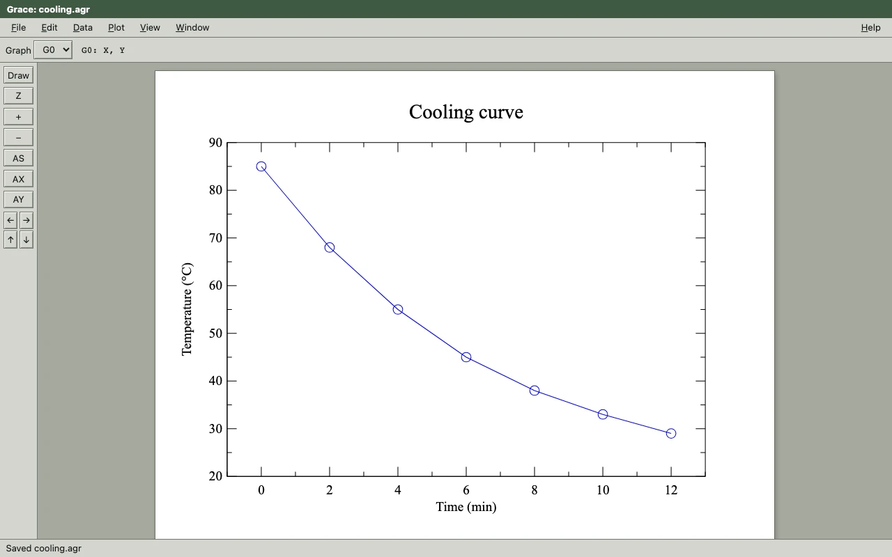

# Grace

A scientific plotting app for researchers, instructors, and students who want to make XY plots in
the browser, edit them with the classic Grace controls, and save projects that desktop Grace can open.

[Open Grace in your browser](https://vosslab.github.io/xmgrace/)

The TypeScript and Rust/WebAssembly port can edit Grace projects, generate data from formulas,
and run data transformations such as FFT and curve fitting. It downloads AGR projects and
SVG, PNG, JPEG, and PDF figures. Projects with unsupported settings open as read-only previews
with diagnostics. [Browser compatibility](docs/WEB_APP.md#compatibility)

## A plot in Grace

The example below turns seven time and temperature readings into a plot with labeled axes.
The data stays in your browser.

<!-- screenshots:begin (managed by screenshot-docs) -->

<!-- screenshots:end -->

## Quick start

For a local macOS build, install the tools with Homebrew. The app uses Node.js 26, Rust 1.100
or newer, and the WebAssembly target. The local preview script uses Python 3.

```bash
brew bundle
rustup toolchain install stable --target wasm32-unknown-unknown
npm ci
PORT=8787 ./run_web_server.sh
```

Open `http://localhost:8787/`. The Grace window opens to a blank graph.

## Make the cooling plot

Choose **Help > Examples** to open the completed plot or a calibration plot with error bars.
To build the cooling plot yourself, import the readings below.

Save these sample readings as `cooling.dat`. Each line contains elapsed minutes and temperature
in degrees Celsius.

```text
0 85
2 68
4 55
6 45
8 38
10 33
12 29
```

1. Choose **Data > Import > ASCII...** and select `cooling.dat`. Grace scales the axes to fit the data.
2. Use **Plot > Axis properties...** to label the X axis **Time (min)** and the Y axis
   **Temperature (&deg;C)**. Use **Plot > Graph appearance...** to title the plot **Cooling curve**.
   To match the screenshot, set the X axis start and stop to `-1` and `13`, then choose
   **Blue** and **Circle** under **Plot > Set appearance...**.
3. Choose **File > Save as...** for an editable `.agr` project, or **Data > Export > SVG...** for a
   vector figure.

## Generate a sine wave and transform it

1. In a blank project, open **Edit > Data sets... > Create new > By formula...**.
2. Enter `0` for **Start**, `2*pi*127/128` for **Stop**, and `128` for **Points**. Use `$t`
   for the X formula and `sin($t)` for the Y formula. Choose **Accept**.
3. Open **Data > Transformations > Fourier transforms...**. Select the sine set, **Fast Fourier
   transform**, and **Magnitude**, then choose **Accept**. The new set has its peak at bin 1.
   To transform the default 100-point sine, select **Direct Fourier transform** instead.

## Documentation

- Build, verify, and check which Grace features are supported. [docs/WEB_APP.md](docs/WEB_APP.md)
- Install desktop Grace or look up its original controls. [Desktop Grace User's Guide](https://plasma-gate.weizmann.ac.il/Grace/doc/UsersGuide.html)
- Work through the original desktop plotting exercises. [Desktop Grace tutorials](https://plasma-gate.weizmann.ac.il/Grace/doc/Tutorial.html)
- Follow browser port changes. [docs/CHANGELOG.md](docs/CHANGELOG.md)
- Read the upstream release history. [Desktop Grace release history](https://plasma-gate.weizmann.ac.il/Grace/doc/CHANGES.html)

## License and credits

Grace stands for GRaphing, Advanced Computation and Exploration of data. The port builds on the
work of Paul J. Turner and the Grace Development Team. [COPYRIGHT](COPYRIGHT)

Grace and the browser port use the GNU General Public License version 2 or later.
[LICENSE.GPL-2.0-or-later](LICENSE.GPL-2.0-or-later)

